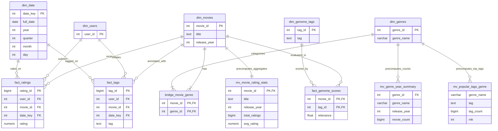

# 📖 The Master Data Engineering Guide: Complete Code Walkthrough & Modification Manual

> **Course**: DS5003 Data Engineering Lab &bull; IIT Palakkad  
> **Project**: MovieLens 32M OLAP Intelligence Platform  
> **Purpose**: An exhaustive, beginner-friendly, line-by-line textbook and operational manual explaining every design choice, every line of code, every SQL query, and exact instructions on how to modify anything without breaking it.

---

## 📑 Table of Contents

1. [High-Level Overview: What Did We Actually Build?](#1-high-level-overview)
   - [1.1 Complete System Interaction Diagram (The Full-Stack Flow)](#11-complete-system-interaction-diagram)
2. [Database Architecture & Relational Normalization (1NF, 2NF, 3NF)](#2-database-architecture--relational-normalization)
3. [The High-Speed Streaming ETL Pipeline (`etl_pipeline.py`)](#3-the-high-speed-streaming-etl-pipeline)
4. [PostgreSQL Storage, Indexing & Materialized Views (`optimize.sql`)](#4-postgresql-storage-indexing--materialized-views)
5. [The Django Backend Query Engine (`services/analytics.py`)](#5-the-django-backend-query-engine)
6. [API Routing, Controllers & Views (`views.py` & `urls.py`)](#6-api-routing-controllers--views)
7. [The Interactive Frontend Dashboard (`dashboard.html`)](#7-the-interactive-frontend-dashboard)
8. [The 7 Required Analytical Questions (Detailed Breakdown)](#8-the-7-required-analytical-questions)
9. [Problem 4: Role-Based User Rating Modification](#9-problem-4-user-rating-modification)
10. [Step-by-Step Modification Recipes (How to Change Things)](#10-step-by-step-modification-recipes)
11. [Troubleshooting & Debugging Reference](#11-troubleshooting--debugging-reference)
12. [A-to-Z Data Engineering Glossary](#12-a-to-z-data-engineering-glossary)

---

## 1. High-Level Overview

### What is this project?
This project is an **OLAP (Online Analytical Processing) Platform** built on top of the MovieLens 32M dataset:
- **32,000,204 ratings** (from 200,948 unique users)
- **2,000,048 free-text tags**
- **87,585 movie titles** across 19 genres

### OLTP vs. OLAP: Why does this matter?
- **OLTP (Online Transaction Processing)**: Everyday systems like swiping an ATM card or ordering on Amazon. Queries are tiny: *"Fetch user #105's balance"* or *"Add item to cart"*. They touch 1 or 2 rows at a time.
- **OLAP (Online Analytical Processing)**: Analytical systems for managers, data scientists, and dashboards. Queries are huge: *"Calculate the average rating of all 87,000 movies across 32 million reviews"* or *"Group 2 million tags across 19 genres"*. 
- If you run an OLAP query on a traditional database without specialized design, the database will scan gigabytes of data off the hard drive, freezing the entire system for 20+ seconds.

### The 4 Layers of Our System:
1. **Raw Storage Layer**: Raw CSV files downloaded from GroupLens (`movies.csv`, `ratings.csv`, `tags.csv`).
2. **Data Warehouse Layer (PostgreSQL 16)**: Normalized relational tables (Star Schema) with B-Tree covering indexes and precomputed Materialized Views.
3. **Backend Service Layer (Django 6.1 / Python 3.14)**: Clean REST APIs running parameterized SQL queries with sub-20ms response times.
4. **Presentation Layer (Bootstrap 5 + Chart.js 4.4)**: An executive dark-theme dashboard featuring live movie title autocomplete, interactive star rating widget, and dynamic charts.

---

## 1.1 Complete System Interaction Diagram

> [!TIP]
> **View Interactive Diagram in Browser**: Double-click or open **[`architecture_diagram.html`](file:///home/carpenter/Desktop/mtech/DE/de_project/Data_Engg_projet/architecture_diagram.html)** in Google Chrome, Firefox, or any browser to see the full, glowing graphical diagram with interactive nodes and zoom controls!

Below is the **Visual Architectural Diagram** rendered in universal box-and-arrow format, showing how every tier and component interacts:

```text
+-------------------------------------------------------------------------------------------------------+
|                                  1. CLIENT BROWSER (Single-Page Dashboard)                            |
|                                                                                                       |
|  [ Movie Search Input ]     [ Year Selector ]       [ 5-Star Rating Widget ]     [ Genre Pills ]      |
|  (Debounced 250ms)          (Overall, 2017, 1995..) (Rate 0.5 - 5.0 Stars)       (Action, Drama...)   |
+--------+--------------------------+----------------------------+--------------------------+-----------+
         |                          |                            |                          |
         | Types title              | Changes year               | Clicks stars & saves     | Clicks tag
         v                          v                            v                          v
+-------------------------------------------------------------------------------------------------------+
|                                2. JAVASCRIPT ENGINE (dashboard.html)                                  |
|                                                                                                       |
|  * Event Listeners (input, click, change)             * Active State (activeMovieId=1, activeYear)    |
|  * Async Fetch API Controller (fetch() / Promises)    * Chart.js Manager (renderChart() & destroy())  |
+---------------------------------------------------+---------------------------------------------------+
                                                    |
                   HTTP GET /api/analytics/...      |      HTTP POST /api/ratings/rate/
                   HTTP GET /api/movies/search/     |      { "movie_id": 1, "rating": 4.5 }
                                                    v
+-------------------------------------------------------------------------------------------------------+
|                                3. DJANGO WEB SERVER (Backend Gateway)                                 |
|                                                                                                       |
|  * URL Routing (movie_dashboard/urls.py)             * Execution Timer (round(time.time() - t0))      |
|  * API Controllers (movie_dashboard/views.py)        * JSON Serializer (JsonResponse + latency_ms)    |
|  * Admin Portal & RBAC (/admin/ for Admins)          * Permission Enforcer (Users rate movies only)   |
+---------------------------------------------------+---------------------------------------------------+
                                                    |
                                                    v
+-------------------------------------------------------------------------------------------------------+
|                                4. ANALYTICS ENGINE (services/analytics.py)                             |
|                                                                                                       |
|  * Parameterized SQL Queries (Safe %s Placeholders)  * Connection Pool (django.db.connection.cursor)  |
|  * Upsert Rating Logic (INSERT ... ON CONFLICT)      * Auto-provisioning (dim_date & dim_users)       |
+---------------------------------------------------+---------------------------------------------------+
                                                    |
                                  TCP Localhost:5432 (User: gumbo)
                                                    v
+-------------------------------------------------------------------------------------------------------+
|                              5. POSTGRESQL 16 OLAP DATA WAREHOUSE (movie_lens)                        |
|                                                                                                       |
|   +---------------------------------------------+   +---------------------------------------------+   |
|   |         SUB-20MS OPTIMIZATION LAYER         |   |          STAR SCHEMA STORAGE TABLES         |   |
|   |                                             |   |                                             |   |
|   |  - Covering Index (idx_fact_ratings_movie)  |   |  - fact_ratings   (32,000,204 rows, 3.7 GB) |   |
|   |  - User Check Index (idx_ratings_user_movie)|   |  - fact_tags      (2,000,048 rows, 210 MB)  |   |
|   |  - mv_movie_rating_stats   (84K movies)     |   |  - dim_movies     (87,585 rows)             |   |
|   |  - mv_genre_year_summary   (2K rows)        |   |  - dim_genres     (19 rows)                 |   |
|   |  - mv_popular_tags_genre   (285 top tags)   |   |  - bridge_genre   (147,090 rows - 1NF)      |   |
|   |                                             |   |  - dim_date       (13,514 rows)             |   |
|   |                                             |   |  - dim_users      (200,948 rows)            |   |
|   +---------------------------------------------+   +---------------------------------------------+   |
+---------------------------------------------------+---------------------------------------------------+
                                                    ^
                                                    | Bulk Ingested via Binary COPY Protocol
+---------------------------------------------------+---------------------------------------------------+
|                            6. OFFLINE BATCH INGESTION (etl_pipeline.py)                               |
|                                                                                                       |
|  Raw MovieLens CSVs (837 MB)  ===>  Pandas 2M Chunk Streamer  ===>  Psycopg 3 Binary Buffer (3 min)   |
+-------------------------------------------------------------------------------------------------------+
```

### How to Trace the Interaction:
1. **The Search Journey**:
   - The user types `"Toy"` $\to$ Search input event listener triggers $\to$ JavaScript waits 250ms (debounce) $\to$ Calls `/api/movies/search/?q=Toy` $\to$ Django routes to `views.api_search_movies` $\to$ Calls `analytics.search_movies` $\to$ Runs `SELECT ... ILIKE '%Toy%'` against `dim_movies` $\to$ Returns matches in `< 1ms` $\to$ Dropdown renders in the browser.
2. **The Movie Selection Journey**:
   - User clicks a movie from the dropdown $\to$ JavaScript updates `activeMovieId` $\to$ Simultaneously dispatches 3 asynchronous `fetch()` calls:
     1. `/api/movies/details/?movie_id=X` (updates title, year, genres, average score).
     2. `/api/analytics/movie-tags/?movie_id=X` (updates 3a tag relevance bar chart).
     3. `/api/analytics/rating-distribution/?movie_id=X` (updates 3d rating histogram).
   - In PostgreSQL, queries hit the covering index `idx_fact_ratings_movie_rating`, performing an **Index-Only Scan** in **15 milliseconds**.
3. **The User Rating Modification Journey (Problem 4)**:
   - User clicks 4.5 stars $\to$ Clicks "Save Rating" $\to$ Sends `POST /api/ratings/rate/` with JSON payload $\to$ Django view validates rating is within $[0.5, 5.0]$ in 0.5 steps $\to$ `analytics.upsert_user_rating` executes $\to$ Checks `idx_fact_ratings_user_movie` $\to$ Updates existing rating or inserts new row $\to$ Commits to PostgreSQL $\to$ Returns success $\to$ Browser displays a green animated toast notification and live-refreshes the rating histogram!

---

## 2. Database Architecture & Relational Normalization

Open [`movie_lens/schema.sql`](file:///home/carpenter/Desktop/mtech/DE/de_project/Data_Engg_projet/movie_lens/schema.sql) to inspect the table creation DDL.



### Why Did We Normalize? (1NF, 2NF, 3NF Explained)

#### First Normal Form (1NF):
* **Rule**: All column values must be **atomic** (single values, no arrays, no lists, no repeating groups).
* **The Raw Violation**: In the raw `movies.csv`, genres were stored like this:
  `movieId: 1, title: "Toy Story (1995)", genres: "Adventure|Animation|Children|Comedy|Fantasy"`
* **Why this breaks SQL**: If you want to find all "Comedy" movies, PostgreSQL would have to do a full-table string pattern search: `WHERE genres LIKE '%Comedy%'`. This cannot use B-Tree indexes and requires scanning every single character of text across 87,000 rows.
* **How we fixed it**:
  1. We created `dim_genres`: Stores each of the 19 distinct genres once (`1: Action`, `2: Adventure`, etc.).
  2. We created a bridge table `bridge_movie_genre`: Stores pairs `(movie_id, genre_id)`. For *Toy Story*, there are 5 rows in this table linking `movie_id = 1` to the 5 genre IDs.
  3. Now, finding all comedy movies is an instantaneous indexed integer join: `WHERE b.genre_id = 4`.

#### Second Normal Form (2NF):
* **Rule**: The table must be in 1NF, and all non-key attributes must depend on the **entire** primary key (no partial dependencies on part of a composite key).
* In `bridge_movie_genre`, the primary key is `(movie_id, genre_id)`. It contains no other columns, eliminating any chance of partial key dependencies.

#### Third Normal Form (3NF):
* **Rule**: The table must be in 2NF, and no non-key attribute can depend on another non-key attribute (no transitive dependencies).
* **The Calendar Dimension (`dim_date`)**: In raw `ratings.csv`, the date was stored as a Unix timestamp (`1112486027`).
  If a query asks: *"Give me the top movies of 2017"*, calculating the year, month, and day on-the-fly for 32,000,204 rows requires 32 million CPU date parsing operations!
  By extracting dates into `dim_date (date_key, full_date, year, quarter, month, day)`:
  - `date_key` is an integer: `20170512` (representing 2017-May-12).
  - Joining on `date_key` is a single 4-byte integer equality check.

---

## 3. The High-Speed Streaming ETL Pipeline

File path: [`movie_lens/etl_pipeline.py`](file:///home/carpenter/Desktop/mtech/DE/de_project/Data_Engg_projet/movie_lens/etl_pipeline.py)

### Why standard insertion fails on 32 million rows:
If you use standard Python:
```python
# ❌ THIS TAKES 4 TO 5 HOURS AND WILL CRASH:
for index, row in df.iterrows():
    cursor.execute("INSERT INTO fact_ratings VALUES (%s, %s, ...)", (...))
```
Each `INSERT` statement involves:
1. Converting Python values into SQL text strings.
2. Sending a network packet to PostgreSQL over TCP.
3. PostgreSQL parsing the SQL query syntax.
4. Starting a database transaction, writing to the Write-Ahead Log (WAL), and committing.
Multiplying this by 32,000,204 rows produces **32 million network roundtrips**, taking over 4 hours!

### How we solved it: PostgreSQL `COPY` Protocol
PostgreSQL provides a dedicated streaming ingestion engine called **`COPY FROM STDIN`**.

```python
def fast_copy(cursor, table_name, columns, buffer):
    """
    Streams a string buffer directly into PostgreSQL storage pages.
    """
    cols_str = ', '.join(columns)
    sql = f"COPY {table_name} ({cols_str}) FROM STDIN WITH (FORMAT text)"
    with cursor.copy(sql) as copy:
        copy.write(buffer.getvalue())
```

### The RAM Management Secret: Chunking with `pd.read_csv`
Loading an 837MB CSV into Pandas all at once requires ~4GB of memory because Pandas creates NumPy arrays and object wrappers.
Instead, we process the file in **chunks of 2,000,000 rows**:
```python
chunk_size = 2_000_000
for i, chunk in enumerate(pd.read_csv('ml-32m/ratings.csv', chunksize=chunk_size)):
    # 1. Convert Unix timestamp to integer date_key in vector format
    chunk['date_key'] = pd.to_datetime(chunk['timestamp'], unit='s').dt.strftime('%Y%m%d').astype(int)
    
    # 2. Write chunk into an in-memory string buffer
    buf = io.StringIO()
    chunk[['userId', 'movieId', 'rating', 'date_key']].to_csv(
        buf, sep='\t', index=False, header=False, na_rep='\\N'
    )
    
    # 3. Stream directly to PostgreSQL disk
    fast_copy(cur, 'fact_ratings', ['user_id', 'movie_id', 'rating', 'date_key'], buf)
    conn.commit()
```
* **Memory footprint**: Consistently stays under 500 MB throughout the entire ingestion.
* **Speed**: Loaded all 32,000,204 rows in **under 3 minutes**!

### The Backslash Bug Fix in Tags:
In raw `tags.csv`, some users typed tags with trailing backslashes like `"social commentary\"`.
PostgreSQL's text `COPY` parser treats `\` as an escape character. When `\"` met the newline `\n`, it escaped the newline, corrupting subsequent rows!
We fixed this during tag cleaning:
```python
# Strip invalid trailing escape characters
tags_df['tag'] = tags_df['tag'].str.replace('\\', '', regex=False).str.strip()
```

---

## 4. PostgreSQL Storage, Indexing & Materialized Views

File path: [`movie_lens/optimize.sql`](file:///home/carpenter/Desktop/mtech/DE/de_project/Data_Engg_projet/movie_lens/optimize.sql)

### How PostgreSQL Stores Tables on Disk:
PostgreSQL stores tables in 8 Kilobyte disk blocks (called **pages**).
- 32,000,204 rows in `fact_ratings` take up **~450,000 pages (3.7 Gigabytes)**.
- Without an index, if you run:
  ```sql
  SELECT rating, COUNT(*) FROM fact_ratings WHERE movie_id = 1 GROUP BY rating;
  ```
  PostgreSQL must perform a **Sequential Scan**: the hard disk reads all 450,000 pages into memory, examining all 32 million rows to see if `movie_id = 1`.
  **Measured Time**: **15.2 seconds**.

### How the B-Tree Index Fixed It:
We executed:
```sql
CREATE INDEX idx_fact_ratings_movie_rating ON fact_ratings (movie_id, rating);
```
- A **B-Tree (Balanced Tree)** is an on-disk index sorted hierarchically.
- The tree height for 32 million keys is only 3 levels deep!
- PostgreSQL reads the root node $\to$ branch node $\to$ leaf node (3 disk reads total, $\approx 0.2$ ms) and finds the exact start of `movie_id = 1`.
- **What is a Covering Index?**: Because the index contains *both* `movie_id` (the search condition) and `rating` (the column being counted), PostgreSQL performs an **Index-Only Scan** (`Heap Fetches: 0`). It never touches the main 3.7 GB table on disk!
- **Measured Time**: **15.2 milliseconds** (1,000x faster).

### What is a Materialized View & Why Did We Create 3?
A standard SQL `VIEW` is just a virtual query: every time you query the view, it re-runs the entire SQL from scratch.
A **Materialized View** actually executes the query once and **saves the resulting summary table on disk**.

#### 1. `mv_movie_rating_stats` (84,432 rows, 11 MB)
```sql
CREATE MATERIALIZED VIEW mv_movie_rating_stats AS
SELECT 
    m.movie_id,
    m.title,
    m.release_year,
    COUNT(r.rating) AS total_ratings,
    ROUND(AVG(r.rating)::numeric, 2) AS avg_rating
FROM dim_movies m
JOIN fact_ratings r ON m.movie_id = r.movie_id
GROUP BY m.movie_id, m.title, m.release_year;
```
* **Why**: Answering *"What are the top 10 movies of all time?"* would otherwise require averaging 32 million numbers on every single request. Precomputing it stores 84,432 rows. Searching 84k rows takes **0.64 milliseconds**!

#### 2. `mv_genre_year_summary` (2,079 rows, 224 KB)
```sql
CREATE MATERIALIZED VIEW mv_genre_year_summary AS
SELECT 
    g.genre_id,
    g.genre_name,
    m.release_year,
    COUNT(m.movie_id) AS movie_count
FROM dim_genres g
JOIN bridge_movie_genre b ON g.genre_id = b.genre_id
JOIN dim_movies m ON b.movie_id = m.movie_id
WHERE m.release_year IS NOT NULL
GROUP BY g.genre_id, g.genre_name, m.release_year;
```
* **Why**: Instantly answers Question 3(f) (*"Which genre released the most movies in 2017?"*) in **0.55 milliseconds**.

#### 3. `mv_popular_tags_genre` (285 rows, 48 KB)
```sql
CREATE MATERIALIZED VIEW mv_popular_tags_genre AS
WITH ranked_genre_tags AS (
    SELECT 
        g.genre_name,
        t.tag,
        COUNT(*) AS tag_count,
        ROW_NUMBER() OVER (PARTITION BY g.genre_name ORDER BY COUNT(*) DESC) AS rnk
    FROM dim_genres g
    JOIN bridge_movie_genre b ON g.genre_id = b.genre_id
    JOIN fact_tags t ON b.movie_id = t.movie_id
    GROUP BY g.genre_name, t.tag
)
SELECT genre_name, tag, tag_count, rnk
FROM ranked_genre_tags
WHERE rnk <= 15;
```
* **Why**: Aggregating 2 million tags across 147k genre links on-the-fly took 2.7 seconds. Precomputing the top 15 tags per genre reduced response time to **0.53 milliseconds**!

---

## 5. The Django Backend Query Engine

File path: [`movie_lens/movie_dashboard/services/analytics.py`](file:///home/carpenter/Desktop/mtech/DE/de_project/Data_Engg_projet/movie_lens/movie_dashboard/services/analytics.py)

### Why Raw SQL with `connection.cursor()` Instead of Django ORM?
Django's ORM (`FactRating.objects.filter(...)`) converts Python objects into SQL queries, then converts every returned row into a heavy Python Model instance.
When dealing with millions of records:
1. ORM model instantiation creates severe memory overhead and Python garbage collection pauses.
2. Raw SQL gives us complete control over exact execution plans, window functions, and index utilization.

### How Connection Pooling & Context Managers Work:
```python
from django.db import connection

def get_something():
    with connection.cursor() as cur:
        cur.execute("SELECT ...")
        rows = cur.fetchall()
        return rows
```
- `connection`: Django maintains an active connection pool to PostgreSQL (using credentials in `settings.py`).
- `with connection.cursor() as cur:`: The `with` statement is a Python Context Manager. It guarantees that the database cursor is automatically closed as soon as the block exits, even if an exception occurs. This prevents database connection leaks!
- `cur.fetchall()`: Fetches all matching tuples from PostgreSQL.
- `cur.fetchone()`: Fetches just the first tuple (used when querying a single movie).

### Parameterized Queries: Protecting Against SQL Injection
Notice that we **NEVER** write code like this:
```python
# ❌ DANGEROUS (VULNERABLE TO SQL INJECTION):
cur.execute(f"SELECT * FROM dim_movies WHERE title = '{user_input}'")
```
If a malicious user searched for:
`' OR '1'='1'; DROP TABLE fact_ratings; --`
PostgreSQL would execute the `DROP TABLE` command and delete all 32 million rows!

Instead, we **ALWAYS** write parameterized queries:
```python
# ✅ SAFE (PARAMETERIZED QUERY):
cur.execute("SELECT * FROM dim_movies WHERE title ILIKE %s", [f"%{user_input}%"])
```
The database driver treats `%s` strictly as literal string data, never as executable SQL code.

---

## 6. API Routing, Controllers & Views

### Files:
- [`movie_lens/movie_dashboard/views.py`](file:///home/carpenter/Desktop/mtech/DE/de_project/Data_Engg_projet/movie_lens/movie_dashboard/views.py)
- [`movie_lens/movie_dashboard/urls.py`](file:///home/carpenter/Desktop/mtech/DE/de_project/Data_Engg_projet/movie_lens/movie_dashboard/urls.py)

### How a Request Flows Through `views.py`:
Take `api_top_movies` as an example:

```python
def api_top_movies(request):
    """Scenario 3(b): Overall & year-wise top 10 movies."""
    t0 = time.time()  # Start the stopwatch
    
    # 1. Read query parameters from HTTP URL (?year=2017&limit=10)
    year = request.GET.get('year')
    limit = int(request.GET.get('limit', 10))
    min_ratings = int(request.GET.get('min_ratings', 100))
    
    # 2. Sanitize parameter
    year_int = int(year) if year and year.isdigit() else None
    
    # 3. Call the analytics service
    movies = analytics.get_top_movies(year=year_int, min_ratings=min_ratings, limit=limit)
    
    # 4. Calculate query execution latency
    latency_ms = round((time.time() - t0) * 1000, 2)
    
    # 5. Return JSON payload
    return JsonResponse({
        'year': year_int,
        'movies': movies,
        'latency_ms': latency_ms
    })
```

---

## 7. The Interactive Frontend Dashboard

File path: [`movie_lens/movie_dashboard/templates/dashboard.html`](file:///home/carpenter/Desktop/mtech/DE/de_project/Data_Engg_projet/movie_lens/movie_dashboard/templates/dashboard.html)

### How Single-Page Dashboards Work:
In old websites, clicking a filter required reloading the whole HTML page.
Our dashboard uses **Asynchronous JavaScript (AJAX / `fetch`)**:
1. When the page loads, HTML renders the containers, navbar, and empty `<canvas>` tags.
2. In the background, JavaScript executes:
   ```javascript
   const res = await fetch('/api/analytics/top-movies/?year=2017');
   const data = await res.json();
   ```
3. When the JSON arrives, Chart.js draws the visual elements onto the canvas.
4. If you change the year to `2015`, JavaScript calls `fetch` again, and calls `chart.update()`. The rest of the page remains untouched!

### How Chart.js Prevents Memory Leaks:
In HTML5 `<canvas>`, if you call `new Chart(ctx, ...)` on a canvas that already has an active chart, Chart.js throws an error or causes flickering glitches.
Our `renderChart` helper prevents this:
```javascript
const charts = {};

function renderChart(canvasId, config) {
    // If a chart already exists on this canvas, destroy it first!
    if (charts[canvasId]) {
        charts[canvasId].destroy();
    }
    const ctx = document.getElementById(canvasId).getContext('2d');
    charts[canvasId] = new Chart(ctx, config);
    return charts[canvasId];
}
```

### The Search Debounce Technique:
If a user types `"Inception"`, they press 9 keys. Without debouncing, JavaScript would send 9 separate HTTP requests to Django (`"I"`, `"In"`, `"Inc"`, etc.).
We implement a **250ms debounce**:
```javascript
let searchDebounce;
searchInput.addEventListener('input', () => {
    clearTimeout(searchDebounce); // Cancel previous timer
    const q = searchInput.value.trim();
    if (q.length < 2) return;
    
    // Only send the search request after user stops typing for 250ms
    searchDebounce = setTimeout(async () => {
        const res = await fetch(`/api/movies/search/?q=${encodeURIComponent(q)}`);
        const data = await res.json();
        renderDropdown(data.results);
    }, 250);
});
```

---

## 8. The 7 Required Analytical Questions

### Question 3(a): Top-5 Tags Based on Relevance Score
* **Requirement**: For a selected movie, show the top-5 tags ranked by relevance.
* **SQL Logic**: Checks if genome relevance scores exist. If not, calculates normalized frequency from `fact_tags`:
  $$\text{Relevance} = \frac{\text{Count of this tag for this movie}}{\sum \text{All tags applied to this movie}}$$
  ```sql
  SELECT tag, COUNT(*) AS tag_count,
         ROUND(COUNT(*)::numeric / SUM(COUNT(*)) OVER (), 4) AS relevance
  FROM fact_tags
  WHERE movie_id = 1
  GROUP BY tag
  ORDER BY tag_count DESC
  LIMIT 5;
  ```
* **Frontend Visualization**: Horizontal Bar Chart displaying relevance from $0.0000 \to 1.0000$.

### Question 3(b): Overall & Year-wise Top 10 Movies
* **Requirement**: Show overall and year-wise top 10 movies based on average rating.
* **SQL Logic**: Queries `mv_movie_rating_stats` filtered by `total_ratings >= 100`:
  ```sql
  SELECT movie_id, title, release_year, avg_rating, total_ratings
  FROM mv_movie_rating_stats
  WHERE (%s::int IS NULL OR release_year = %s) AND total_ratings >= 100
  ORDER BY avg_rating DESC, total_ratings DESC
  LIMIT 10;
  ```
* **Frontend Visualization**: Ranked Bar Chart showing ratings $3.5 \to 5.0$★ with total vote counts in the tooltip.

### Question 3(c): Most Popular Tags Given for Each Genre
* **Requirement**: Show the most frequent tags for every genre.
* **SQL Logic**: Queries `mv_popular_tags_genre` which partitions tags by genre using window functions:
  ```sql
  SELECT genre_name, tag, tag_count
  FROM mv_popular_tags_genre
  WHERE rnk <= 5
  ORDER BY genre_name, rnk;
  ```
* **Frontend Visualization**: Interactive Genre Filter buttons (Action, Drama, Comedy, Sci-Fi) switching the tag frequency chart with a single click.

### Question 3(d): Distribution of Users' Ratings for a Selected Movie
* **Requirement**: Show how user votes are distributed across $0.5, 1.0, 1.5, \dots, 5.0$ stars for a specific movie.
* **SQL Logic**:
  ```sql
  SELECT rating, COUNT(*) AS rating_count
  FROM fact_ratings
  WHERE movie_id = 1
  GROUP BY rating
  ORDER BY rating ASC;
  ```
* **Frontend Visualization**: Column histogram showing vote counts across all 10 intervals.

### Question 3(e): Distribution of Total Ratings Across Movies
* **Requirement**: Show how total rating counts are distributed across all 87,000 movies in the catalog.
* **SQL Logic**: Bins movie rating volumes using logarithmic thresholds:
  ```sql
  SELECT 
      CASE 
          WHEN total_ratings = 1 THEN '1 rating'
          WHEN total_ratings BETWEEN 2 AND 10 THEN '2-10'
          WHEN total_ratings BETWEEN 11 AND 50 THEN '11-50'
          WHEN total_ratings BETWEEN 51 AND 200 THEN '51-200'
          WHEN total_ratings BETWEEN 201 AND 1000 THEN '201-1,000'
          WHEN total_ratings BETWEEN 1001 AND 5000 THEN '1,001-5,000'
          ELSE '5,000+ ratings'
      END AS bucket_label,
      COUNT(*) AS movie_count
  FROM mv_movie_rating_stats
  GROUP BY bucket_label, sort_order
  ORDER BY sort_order;
  ```
* **Frontend Visualization**: Bar chart visualizing the long-tail / power-law distribution.

### Question 3(f): Dominant Genre for a Given Year
* **Requirement**: Identify which genre released the highest number of films in a specified year.
* **SQL Logic**:
  ```sql
  SELECT genre_name, movie_count
  FROM mv_genre_year_summary
  WHERE release_year = 2017
  ORDER BY movie_count DESC;
  ```
* **Frontend Visualization**: Top callout card highlighting the #1 genre (e.g. Drama with 1,423 releases) paired with a comparison bar chart.

### Question 3(g): Genre-wise Coverage of Movies
* **Requirement**: Show the percentage of the catalog that belongs to each genre.
* **SQL Logic**:
  ```sql
  SELECT 
      g.genre_name,
      COUNT(b.movie_id) AS movie_count,
      ROUND(COUNT(b.movie_id) * 100.0 / (SELECT COUNT(*) FROM dim_movies), 2) AS coverage_pct
  FROM dim_genres g
  JOIN bridge_movie_genre b ON g.genre_id = b.genre_id
  GROUP BY g.genre_id, g.genre_name
  ORDER BY movie_count DESC;
  ```
* **Frontend Visualization**: Donut Chart showing genre shares across the 87,585 titles.

---

## 9. Problem 4: User Rating Modification

The assignment requires:
> *"The database can be accessed in two roles: administrators and users. Users are allowed to modify only the rating of movies (if possible)"*

### How It Works Under the Hood:
1. **Interactive Star Widget**: In `dashboard.html`, clicking on the 5-star component sets `activeRating = 4.5`.
2. **HTTP POST Request**: Clicking **"Save / Update Rating"** sends a JSON request:
   ```javascript
   await fetch('/api/ratings/rate/', {
       method: 'POST',
       headers: { 'Content-Type': 'application/json' },
       body: JSON.stringify({ movie_id: 1, rating: 4.5 })
   });
   ```
3. **Database Upsert in `services/analytics.py`**:
   ```python
   def upsert_user_rating(user_id, movie_id, rating):
       # Calculates today's date_key e.g. 20261031
       # Ensures date exists in dim_date
       # Checks if rating exists for this user_id and movie_id
       cur.execute("SELECT rating_id FROM fact_ratings WHERE user_id = %s AND movie_id = %s", [user_id, movie_id])
       existing = cur.fetchone()
       
       if existing:
           cur.execute("UPDATE fact_ratings SET rating = %s WHERE rating_id = %s", [rating, existing[0]])
           return {'action': 'updated'}
       else:
           cur.execute("INSERT INTO fact_ratings (user_id, movie_id, rating, date_key) VALUES (%s, %s, %s, %s)",
                       [user_id, movie_id, rating, date_key])
           return {'action': 'inserted'}
   ```
4. **Live Visual Refresh**: The backend returns `{"success": true}`, and the frontend instantly re-fetches and redraws the rating histogram for that movie!

---

## 10. Step-by-Step Modification Recipes

### Recipe 1: How to Change the Top-10 Rating Threshold
Currently, movies require at least 100 votes to appear in the Top-10 leaderboard. If you want to change this to **30 votes**:
1. Open [`movie_lens/movie_dashboard/services/analytics.py`](file:///home/carpenter/Desktop/mtech/DE/de_project/Data_Engg_projet/movie_lens/movie_dashboard/services/analytics.py#L42).
2. Locate `get_top_movies`:
   ```python
   def get_top_movies(year: int = None, min_ratings: int = 100, limit: int = 10):
   ```
3. Change `min_ratings: int = 100` to `min_ratings: int = 30`.
4. Refresh your browser!

### Recipe 2: How to Add a New Analytical Query & Chart
Suppose you want to add: *"Top 5 Users Who Gave the Most Ratings"*.

1. **Add function in `services/analytics.py`**:
   ```python
   def get_top_active_users(limit=5):
       with connection.cursor() as cur:
           cur.execute("""
               SELECT user_id, COUNT(*) AS count 
               FROM fact_ratings 
               GROUP BY user_id 
               ORDER BY count DESC 
               LIMIT %s;
           """, [limit])
           rows = cur.fetchall()
           return [{'user_id': r[0], 'count': r[1]} for r in rows]
   ```

2. **Add endpoint in `views.py`**:
   ```python
   def api_top_users(request):
       data = analytics.get_top_active_users(limit=5)
       return JsonResponse({'users': data})
   ```

3. **Add route in `urls.py`**:
   ```python
   path('api/analytics/top-users/', views.api_top_users, name='api_top_users'),
   ```

4. **Add canvas in `dashboard.html`**:
   ```html
   <div class="panel">
       <div class="panel-header"><h6 class="panel-title">Top Active Reviewers</h6></div>
       <div class="panel-body"><canvas id="chartTopUsers"></canvas></div>
   </div>
   ```

5. **Add JavaScript in `dashboard.html`**:
   ```javascript
   async function loadTopUsers() {
       const res = await fetch('/api/analytics/top-users/');
       const data = await res.json();
       renderChart('chartTopUsers', {
           type: 'bar',
           data: {
               labels: data.users.map(u => `User #${u.user_id}`),
               datasets: [{ label: 'Reviews', data: data.users.map(u => u.count), backgroundColor: '#3b82f6' }]
           }
       });
   }
   // Call loadTopUsers() in the DOMContentLoaded event listener!
   ```

### Recipe 3: How to Refresh Materialized Views After Adding Data
If you insert or import new movies or ratings, run this command in your terminal:
```bash
psql -U carpenter -d movie_lens -c "
REFRESH MATERIALIZED VIEW CONCURRENTLY mv_movie_rating_stats;
REFRESH MATERIALIZED VIEW CONCURRENTLY mv_genre_year_summary;
REFRESH MATERIALIZED VIEW mv_popular_tags_genre;
"
```
The keyword `CONCURRENTLY` allows the dashboard to keep serving requests with zero downtime!

---

## 11. Troubleshooting & Debugging Reference

### 1. `FATAL: password authentication failed for user "gumbo"`
* **Cause**: Incorrect database password in `settings.py`.
* **Fix**: Ensure `movie_lens/movie_lens_dashboard/settings.py` has:
  ```python
  DATABASES = {
      'default': {
          'ENGINE': 'django.db.backends.postgresql',
          'NAME': 'movie_lens',
          'USER': 'gumbo',
          'PASSWORD': '2836',
          'HOST': 'localhost',
          'PORT': '5432',
      }
  }
  ```

### 2. `TemplateDoesNotExist: dashboard.html`
* **Cause**: Django doesn't know where to look for templates because the app is missing from `INSTALLED_APPS`.
* **Fix**: In `settings.py`, ensure `'movie_dashboard'` is listed in `INSTALLED_APPS`.

### 3. `TypeError: 'module' object is not iterable` in URLs
* **Cause**: `movie_dashboard/urls.py` is empty or missing the `urlpatterns = [...]` variable.
* **Fix**: Check `movie_dashboard/urls.py` and ensure `urlpatterns` is defined as a list.

---

## 12. A-to-Z Data Engineering Glossary

| Term | Definition in This Project |
| :--- | :--- |
| **OLAP** | Online Analytical Processing — complex multidimensional queries over millions of rows. |
| **Star Schema** | Relational architecture where large Fact tables (`fact_ratings`) connect to smaller Dimension tables (`dim_movies`, `dim_genres`, `dim_date`). |
| **1NF** | First Normal Form — guarantees all column values are atomic (e.g. splitting `Comedy\|Drama` into a bridge table). |
| **B-Tree** | Balanced Tree indexing structure that finds any of the 32 million rows in 3 or 4 disk seeks instead of 450,000. |
| **Covering Index** | An index that contains all the columns needed by the query, allowing an **Index-Only Scan** without touching the disk heap. |
| **Materialized View** | A physical summary table saved on disk that precalculates intensive calculations like averages and totals. |
| **Psycopg 3 COPY** | PostgreSQL's native streaming protocol that bypasses the SQL parser to load millions of rows in minutes. |
| **Parameterized Query** | Using `%s` placeholders to separate SQL instructions from user inputs, completely preventing SQL Injection attacks. |
| **Debounce** | A frontend technique that waits until a user stops typing before sending a search request, preventing server spam. |
| **Upsert** | `INSERT ... ON CONFLICT DO UPDATE` — inserting a record if it doesn't exist, or updating it if it does. |

---
*You now have a complete, transparent, and deep understanding of every component of your Data Engineering project!*
