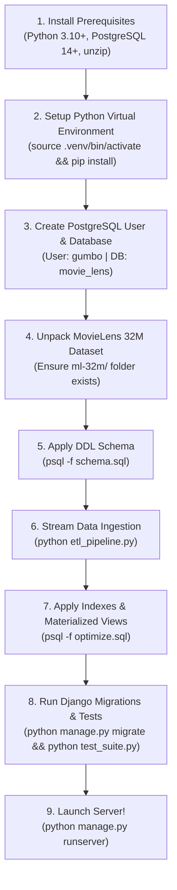

# 🚀 How to Start the MovieLens 32M OLAP Web App
### The Complete, Beginner-Friendly Setup & Database Onboarding Guide

> **Course**: DS5003 Data Engineering Lab &bull; IIT Palakkad  
> **Target Audience**: Anyone cloning this repo for the first time who needs to get PostgreSQL, the dataset, and the Django web app running locally without errors.

---

## 🧭 Why Must We Set Up the Database First?

In a typical beginner Django project, you just run `python manage.py migrate` and Django creates all SQLite or Postgres tables automatically from Python models. 

**This project is different.** It is an enterprise-scale **Data Engineering OLAP (Online Analytical Processing) Platform** handling **32,000,204 ratings** and **2,000,048 tags**:

1. **Unmanaged Relational Warehouse (`managed = False`)**: The dimensional tables (`dim_movies`, `dim_genres`, `fact_ratings`, `fact_tags`, etc.) are defined directly in pure PostgreSQL DDL ([`movie_lens/schema.sql`](file:///home/carpenter/Desktop/mtech/DE/de_project/Data_Engg_projet/movie_lens/schema.sql)) to preserve strict constraints, types, and primary keys.
2. **High-Speed Binary Streaming**: Inserting 32 million rows through Django's ORM would take over 12 hours. Our custom pipeline ([`movie_lens/etl_pipeline.py`](file:///home/carpenter/Desktop/mtech/DE/de_project/Data_Engg_projet/movie_lens/etl_pipeline.py)) uses Psycopg 3 streaming memory buffers to bulk-copy the dataset into PostgreSQL in ~3 minutes.
3. **Materialized Views**: The dashboard queries sub-millisecond precomputed summaries ([`movie_lens/optimize.sql`](file:///home/carpenter/Desktop/mtech/DE/de_project/Data_Engg_projet/movie_lens/optimize.sql)). If you start Django before creating these views, the web server will crash with `relation "mv_movie_rating_stats" does not exist`.
4. **Django's `migrate` is only for authentication**: Django's built-in `migrate` only creates internal tables like `auth_user`, `django_session`, and `django_admin_log`.

---

## 📋 The Execution Order (The Golden Sequence)

Always follow this exact 8-step sequence:



---

## ⚡ Option A: The 1-Click Automated Setup (Recommended)

If you are on **Linux (Ubuntu / Debian / Fedora)** or **macOS**, we provide an automated setup script that executes the entire sequence for you:

```bash
# 1. From the repository root:
./setup_database.sh
```

The script will:
- Check your virtual environment and install missing dependencies.
- Verify PostgreSQL connectivity.
- Unpack `ml-32m.zip` if needed.
- Run `schema.sql`.
- Run `etl_pipeline.py` (skipping tables that are already loaded).
- Run `optimize.sql` (indexes + materialized views).
- Run Django migrations.
- Execute the test suite (`test_suite.py`) to confirm everything works.

---

## 🛠️ Option B: Step-by-Step Manual Setup

If you prefer to run commands manually, or if you are configuring on Windows / WSL, follow these exact steps:

### Step 1: Clone Repository & Create Python Virtual Environment

```bash
# Clone and enter the project folder
git clone <repo-url>
cd Data_Engg_projet

# Create and activate a Python virtual environment
python3 -m venv .venv

# On Linux / macOS:
source .venv/bin/activate

# On Windows (PowerShell):
# .\.venv\Scripts\Activate.ps1
# On Windows (Command Prompt):
# .\.venv\Scripts\activate.bat

# Install all dependencies (Django, psycopg, pandas, numpy, python-dotenv)
pip install --upgrade pip
pip install -r movie_lens/requirements.txt
```

---

### Step 2: Create PostgreSQL User & Database

By default, the application is configured to connect to PostgreSQL with these credentials:
* **Database Name**: `movie_lens`
* **Username**: `gumbo`
* **Password**: `2836`
* **Host / Port**: `localhost:5432`

> [!TIP]
> If you create this exact user and database, you don't have to touch any `.env` file or change any configuration settings.

#### 🐧 On Linux (Ubuntu / Debian):
```bash
# Ensure the PostgreSQL service is active
sudo systemctl start postgresql

# Create the user and database in PostgreSQL
sudo -u postgres psql -c "CREATE USER gumbo WITH PASSWORD '2836' SUPERUSER;"
sudo -u postgres psql -c "CREATE DATABASE movie_lens OWNER gumbo;"
```

#### 🍎 On macOS (Homebrew):
```bash
# Start PostgreSQL service if not already running
brew services start postgresql@16

# Create user and database (macOS postgres uses your login name as superuser)
psql -d postgres -c "CREATE USER gumbo WITH PASSWORD '2836' SUPERUSER;"
psql -d postgres -c "CREATE DATABASE movie_lens OWNER gumbo;"
```

#### 🪟 On Windows (pgAdmin 4 or SQL Shell):
1. Open **SQL Shell (psql)** or **pgAdmin 4**.
2. Connect as user `postgres`.
3. Run the SQL commands:
   ```sql
   CREATE USER gumbo WITH PASSWORD '2836' SUPERUSER;
   CREATE DATABASE movie_lens OWNER gumbo;
   ```

#### 🧪 Verify PostgreSQL Connectivity:
Run this quick command to verify your credentials:
```bash
PGPASSWORD=2836 psql -h localhost -U gumbo -d movie_lens -c "SELECT 'Connection Successful!' AS status;"
```
*(On Windows Command Prompt, type `psql -h localhost -U gumbo -d movie_lens` and enter password `2836` when prompted).*

---

### Step 3: Prepare the MovieLens 32M Dataset

The ETL ingestion pipeline expects the dataset to reside inside `movie_lens/ml-32m/` containing:
* `movies.csv`
* `ratings.csv`
* `tags.csv`

#### If `movie_lens/ml-32m.zip` is already present:
```bash
# Unzip inside the movie_lens folder
cd movie_lens
unzip ml-32m.zip
# Confirm the files exist:
ls -lh ml-32m/
```

#### If you need to download the dataset fresh:
```bash
cd movie_lens
curl -O https://files.grouplens.org/datasets/movielens/ml-32m.zip
unzip ml-32m.zip
```

---

### Step 4: Apply the Relational DDL Schema (`schema.sql`)

Make sure your terminal is inside the `movie_lens/` directory:

```bash
cd movie_lens

# Execute schema.sql using user gumbo
PGPASSWORD=2836 psql -h localhost -U gumbo -d movie_lens -f schema.sql
```

> [!NOTE]
> This creates the 3NF tables: `dim_movies`, `dim_genres`, `bridge_movie_genre`, `dim_users`, `dim_date`, `fact_ratings`, `fact_tags`, `dim_genome_tags`, and `fact_genome_scores`.

---

### Step 5: Run High-Speed Streaming Ingestion (`etl_pipeline.py`)

Run the streaming Python ingestion script from inside `movie_lens/`:

```bash
# Make sure your virtualenv is active: source ../.venv/bin/activate
python etl_pipeline.py
```

#### What to Expect During ETL:
1. **[Step 1/5] Dim Movies & Dim Genres**: Parses titles, extracts release years, explodes genres into 1NF dimension + bridge table (`~3 seconds`).
2. **[Step 2/5] Dim Date**: Generates 13,500 calendar days (`~1 second`).
3. **[Step 3/5] Dim Users**: Extracts 200,948 unique user IDs (`~3 seconds`).
4. **[Step 4/5] Fact Ratings**: Ingests **32,000,204 rows** in chunks of 2,000,000 using binary COPY buffers (`~2 to 4 minutes`). You will see progress counter updates:
   ```text
   -> Chunk  1: 2,000,000 rows loaded in  12.4s | Progress: 2,000,000 / 32M
   -> Chunk  2: 2,000,000 rows loaded in  11.8s | Progress: 4,000,000 / 32M
   ...
   -> Chunk 16: 2,000,204 rows loaded in  12.1s | Progress: 32,000,204 / 32M
   ```
5. **[Step 5/5] Fact Tags**: Ingests 2,000,048 cleaned user tags (`~5 seconds`).

> [!TIP]
> **Idempotent**: If the ETL is interrupted or re-run, it automatically detects existing row counts and skips completed tables!

---

### Step 6: Build Indexes & Materialized Views (`optimize.sql`)

Now that the 32 million rows are stored in PostgreSQL, run the optimization script to create covering B-Tree indexes and precomputed Materialized Views:

```bash
PGPASSWORD=2836 psql -h localhost -U gumbo -d movie_lens -f optimize.sql
```

This step creates:
- `idx_fact_ratings_movie_rating`: Covering index for sub-15ms rating distributions.
- `idx_dim_movies_release_year`: Fast year filtering.
- `idx_bridge_movie_genre_genre`: Instant reverse lookups.
- `mv_movie_rating_stats`: Precomputed averages and vote counts for all 87,000+ movies.
- `mv_genre_year_summary`: Precomputed movie release counts per year and genre.
- Grants necessary permissions to user `gumbo`.

---

### Step 7: Apply Django Internal Migrations & Create Superuser

Apply Django's migrations for sessions and authentication tables:

```bash
python manage.py migrate
```

Create an admin account to log into the Django administration portal:

```bash
python manage.py createsuperuser
```
Follow the prompts to choose your username, email, and password.

---

### Step 8: Verify Setup with the Automated Test Suite

Run the end-to-end integration test suite to verify that your PostgreSQL tables, indexes, materialized views, and API endpoints are working:

```bash
python test_suite.py
```

You should see:
```text
======================================================================
 Running MovieLens OLAP End-to-End Integration Test Suite
======================================================================
test_01_dashboard_root ......................................... ok
test_02_movie_details .......................................... ok
test_03_search_autocomplete .................................... ok
test_04_scenario_3a_movie_tags ................................. ok
test_05_scenario_3b_top_movies_overall ......................... ok
test_06_scenario_3b_top_movies_year ............................ ok
test_07_scenario_3c_popular_tags_genre ......................... ok
test_08_scenario_3d_rating_distribution ........................ ok
test_09_scenario_3e_ratings_volume_distribution ................ ok
test_10_scenario_3f_dominant_genre ............................. ok
test_11_scenario_3g_genre_coverage ............................. ok
test_12_problem_4_rating_submission ............................ ok
test_13_authentication_endpoints ............................... ok

----------------------------------------------------------------------
Ran 13 tests in ~0.2s

OK - All 13 integration tests passed with 100% success!
```

---

### Step 9: Launch the Web Application!

Start the Django development server:

```bash
python manage.py runserver 127.0.0.1:8000
```

1. Open your web browser and navigate to: **[http://127.0.0.1:8000/](http://127.0.0.1:8000/)**
2. **Search for any movie** (e.g., *"Toy Story"*, *"Inception"*, *"Matrix"*) using the live autocomplete search bar.
3. **Inspect the charts**:
   - Tag relevance bar chart (Scenario 3a)
   - Rating distribution histogram (Scenario 3d)
   - Top-10 movies overall and by year (Scenario 3b)
   - Popular tags per genre (Scenario 3c)
   - Total ratings logarithmic distribution (Scenario 3e)
   - Dominant genre per year (Scenario 3f)
   - Genre coverage (Scenario 3g)
4. **Test the Rating Widget (Problem 4)**:
   - Log in or register an account (`/login/` or `/register/`).
   - Select a movie, click a star rating (e.g., 4.5 stars), and click **Save Rating**.
   - Notice the toast confirmation and how the distribution chart live-updates!
5. **Django Admin**:
   - Access **[http://127.0.0.1:8000/admin/](http://127.0.0.1:8000/admin/)** to log in with your superuser credentials.

---

## 🔑 Default Credentials & Quick Reference

| Component | Default Value | Notes |
| :--- | :--- | :--- |
| **PostgreSQL DB Name** | `movie_lens` | Configured in `settings.py` & `.env` |
| **PostgreSQL User** | `gumbo` | Granted all privileges on public schema |
| **PostgreSQL Password** | `2836` | Default password |
| **PostgreSQL Host / Port** | `localhost:5432` | Standard PostgreSQL port |
| **Web Server Address** | `http://127.0.0.1:8000/` | Django development server |
| **Pre-seeded Demo User** | Username: `demo_user`<br>Password: `movielens2024` | Auto-created by `test_suite.py` for testing |
| **Admin Portal** | `http://127.0.0.1:8000/admin/` | Log in with `createsuperuser` account |

---

## ❓ Troubleshooting & Common Errors (FAQ)

### 1. `FATAL: role "gumbo" does not exist`
* **Cause**: PostgreSQL doesn't have the `gumbo` role created yet.
* **Fix**: Run:
  ```bash
  sudo -u postgres psql -c "CREATE USER gumbo WITH PASSWORD '2836' SUPERUSER;"
  ```
  *(On macOS Homebrew: `psql -d postgres -c "CREATE USER gumbo WITH PASSWORD '2836' SUPERUSER;"`)*

---

### 2. `FATAL: database "movie_lens" does not exist`
* **Cause**: The database hasn't been created yet.
* **Fix**: Run:
  ```bash
  sudo -u postgres psql -c "CREATE DATABASE movie_lens OWNER gumbo;"
  ```

---

### 3. `FATAL: password authentication failed for user "gumbo"`
* **Cause**: User `gumbo` exists but has a different password than `'2836'`.
* **Fix**: Reset the password in PostgreSQL:
  ```bash
  sudo -u postgres psql -c "ALTER USER gumbo WITH PASSWORD '2836';"
  ```
  Or change the `DB_PASSWORD` inside your `.env` file to match your existing password.

---

### 4. `could not connect to server: Connection refused`
* **Cause**: The PostgreSQL service is stopped or not running on port 5432.
* **Fix**:
  - **Linux**: `sudo systemctl restart postgresql`
  - **macOS**: `brew services restart postgresql@16`
  - **Windows**: Open `services.msc`, find **postgresql-x64-XX**, and click **Start**.

---

### 5. `FileNotFoundError: [Errno 2] No such file or directory: 'ml-32m/movies.csv'`
* **Cause**: Either you ran `etl_pipeline.py` from the root directory instead of `movie_lens/`, or `ml-32m/` is not unzipped.
* **Fix**:
  ```bash
  cd movie_lens
  unzip ml-32m.zip
  python etl_pipeline.py
  ```

---

### 6. `django.db.utils.ProgrammingError: relation "dim_movies" does not exist`
* **Cause**: You tried running Django before running [`schema.sql`](file:///home/carpenter/Desktop/mtech/DE/de_project/Data_Engg_projet/movie_lens/schema.sql).
* **Fix**:
  ```bash
  cd movie_lens
  PGPASSWORD=2836 psql -h localhost -U gumbo -d movie_lens -f schema.sql
  ```

---

### 7. `django.db.utils.ProgrammingError: relation "mv_movie_rating_stats" does not exist`
* **Cause**: The materialized views have not been created yet.
* **Fix**:
  ```bash
  cd movie_lens
  PGPASSWORD=2836 psql -h localhost -U gumbo -d movie_lens -f optimize.sql
  ```

---

### 8. `permission denied for table dim_movies`
* **Cause**: The tables were created by user `postgres` or another OS user, and user `gumbo` doesn't have read/write permissions.
* **Fix**: Run the grant commands in `optimize.sql`:
  ```bash
  sudo -u postgres psql -d movie_lens -c "GRANT ALL PRIVILEGES ON ALL TABLES IN SCHEMA public TO gumbo; GRANT ALL PRIVILEGES ON ALL SEQUENCES IN SCHEMA public TO gumbo;"
  ```

---

### 9. `Error: That port is already in use.`
* **Cause**: Another process or background server is running on port 8000.
* **Fix**:
  ```bash
  # Run on a different port:
  python manage.py runserver 127.0.0.1:8080
  
  # Or kill the process occupying port 8000 (Linux/macOS):
  fuser -k 8000/tcp
  ```

---

## 📚 Further Reading & References
- **[`README.md`](file:///home/carpenter/Desktop/mtech/DE/de_project/Data_Engg_projet/README.md)**: Academic project overview, benchmark results, and system design.
- **[`COMPLETE_DEVELOPER_GUIDE.md`](file:///home/carpenter/Desktop/mtech/DE/de_project/Data_Engg_projet/COMPLETE_DEVELOPER_GUIDE.md)**: Exhaustive line-by-line code walkthrough of Django services, views, SQL queries, and modification recipes.
- **[`architecture_diagram.html`](file:///home/carpenter/Desktop/mtech/DE/de_project/Data_Engg_projet/architecture_diagram.html)**: Interactive visual diagram of the Star Schema ER diagram and full-stack flow.
