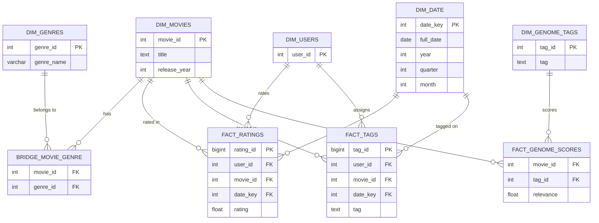
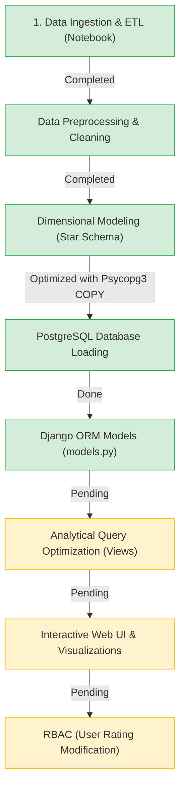

# DS5003 Data Engineering Lab — MovieLens OLAP Dashboard Project

## 1. Project Overview

This repository hosts the course project for **DS5003: Data Engineering Lab** taught by **Dr. Koninika Pal** at **IIT Palakkad** (handout date: 15.10.2026).

The objective is to design and implement an end-to-end data engineering architecture using the **MovieLens Dataset**. The pipeline extracts, normalizes, and models multi-million row datasets into an **OLAP Star/Snowflake Schema** in **PostgreSQL**, exposed via a **Django Web Application** featuring role-based access control (RBAC) and interactive analytics.

---

## 2. Core Problem Statement & Requirements

### A. Data Processing & Modeling
- Ingest raw MovieLens CSV files (`movies.csv`, `ratings.csv`, `tags.csv`, `links.csv`, and genome relevance datasets).
- Clean and normalize the data into 1NF and star/snowflake dimensional tables optimized for analytical queries.
- Optimize bulk loading for high-volume fact tables (e.g., 32M+ rating rows).

### B. Analytical Dashboard Scenarios
The dashboard must answer and visualize seven analytical questions:

| Scenario | Objective | Query / Visualization Focus |
| :--- | :--- | :--- |
| **(a) Top-5 Tags Relevance** | For a selected movie, show the top-5 tags ranked by relevance score | Bar chart / Tag cloud ranking tag relevance (`genome-scores`) |
| **(b) Top 10 Movies** | Overall and year-wise top 10 movies based on average rating | Filterable leaderboard / Bar chart with minimum vote threshold |
| **(c) Popular Tags by Genre** | Identify the most frequent / popular tags per genre | Frequency aggregation grouped by genre |
| **(d) Movie Rating Distribution** | For a specific movie, visualize the distribution of user ratings (0.5 to 5.0) | Histogram / Frequency distribution |
| **(e) Total Ratings Distribution** | Show the distribution of total rating counts across all movies | Log-scale histogram / Density curve (long-tail analysis) |
| **(f) Dominant Genre by Year** | Identify which genre released the highest number of movies for a chosen year | Filterable metric card / Year-over-year bar chart |
| **(g) Genre Coverage** | Visualize overall genre-wise coverage of movies in the catalog | Treemap / Donut chart showing movie counts per genre |

### C. Authentication & Role-Based Access Control (RBAC)
- **Administrators**: Full access to analytics, database management, and administration panel.
- **Regular Users**: Can view dashboards and are authorized to **modify/submit movie ratings**.

---

## 3. Data Architecture & Dimensional Schema

The relational structure transitions raw flat files into an OLAP dimensional model:



---

## 4. Current Codebase Structure

```
Data_Engg_projet/
├── README.md                      # Repository guide and reference links
├── PROJECT_OVERVIEW.md            # Comprehensive project overview & schema
├── project_description-1.pdf      # Official course lab assignment handout
└── movie_lens/
    ├── manage.py                  # Django administrative script
    ├── requirements.txt           # Virtual environment package freeze
    ├── db.sqlite3                 # Local SQLite (Django internal tables)
    ├── data_engg.ipynb            # Jupyter notebook for ETL, cleaning & COPY ingestion
    ├── movie_lens_dashboard/      # Core Django project settings
    │   ├── settings.py            # Database configuration (PostgreSQL target)
    │   ├── urls.py                # Root routing
    │   ├── wsgi.py / asgi.py      # WSGI/ASGI application gateways
    └── movie_dashboard/           # Analytical application app
        ├── models.py              # Unmanaged Django ORM models for OLAP tables
        ├── views.py               # View controllers (currently skeleton)
        ├── admin.py               # Admin registration
        └── apps.py                # App configuration
```

---

## 5. Implementation Status & Progress



### Key Technical Achievements
1. **Title Parsing & Cleaning**: Regex-based extraction of `release_year` from strings like `"Toy Story (1995)"`.
2. **Genre Normalization**: Exploding delimited genre strings (`"Animation|Children|Comedy"`) into a relational bridge entity `bridge_movie_genre`.
3. **High-Speed Ingestion Pipeline**: Migrated from standard slow ORM/DataFrame `to_sql` inserts to high-performance in-memory stream batching using PostgreSQL `COPY` with `psycopg3`.
4. **Django ORM Mapping**: Established `managed = False` models directly representing the OLAP entities in `movie_dashboard/models.py`.

---

## 6. Next Steps & Action Plan

> [!IMPORTANT]
> **Key Attention Item for Question 3(a)**:
> In `data_engg.ipynb`, `movies.csv`, `ratings.csv`, and `tags.csv` are processed, but **`genome-scores.csv`** and **`genome-tags.csv`** are required to calculate the **relevance scores** for Question 3(a) (*"For a particular movie, show the top-5 tags based on the relevance scores of the tags for that movie"*).

### Recommended Implementation Roadmap:
1. **Complete Tag Relevance ETL**: Ingest `genome-scores.csv` and `genome-tags.csv` into the dimensional schema.
2. **Build Django Query Views ([views.py](movie_lens/movie_dashboard/views.py))**:
   - Write optimized Django ORM aggregation queries or raw SQL queries for each of the 7 dashboard scenarios.
3. **Construct Dashboard Templates & Visualizations**:
   - Add frontend templates using Chart.js or Plotly for rendering bar charts, distributions, and coverage charts.
4. **Implement User Rating Modification & Authentication**:
   - Set up user login/registration.
   - Add a form allowing authenticated users to add or edit their movie rating (`FactRating` upsert).
