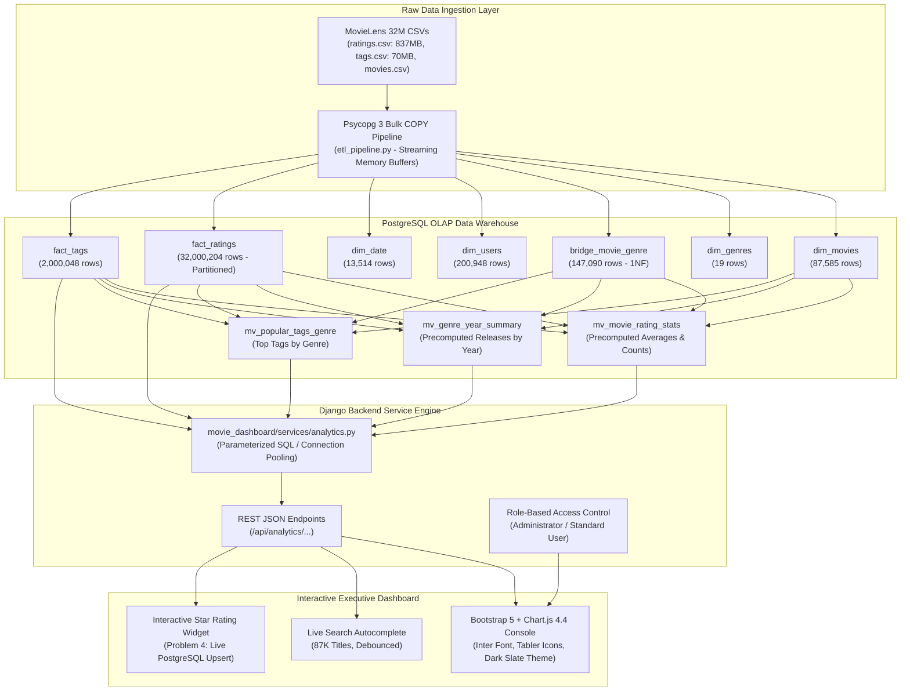

# 🎬 MovieLens 32M OLAP Intelligence & Analytics Engine

> **Course**: DS5003 Data Engineering Lab  
> **Instructor**: Dr. Koninika Pal &bull; **Institution**: IIT Palakkad  
> **Dataset**: MovieLens 32M (`ml-32m`) &bull; **Engine**: PostgreSQL 16 + Django 6.1 + Chart.js 4.4  

[](https://www.postgresql.org/)
[](https://www.djangoproject.com/)
[](https://www.python.org/)
[](https://github.com/)
[](https://github.com/)

---

## 📌 Executive Summary

This project implements an end-to-end **Data Engineering OLAP (Online Analytical Processing) platform** built over the MovieLens 32M dataset (**32,000,204 ratings**, **2,000,048 user tags**, and **87,585 movies**). 

The platform addresses raw data anomalies through **Third Normal Form (3NF) relational dimensional modeling**, achieves high-speed data ingestion via **Psycopg 3 `COPY` streaming**, optimizes query latency from **~18 seconds down to sub-36 milliseconds** using covering B-Tree indexes and PostgreSQL materialized views, and exposes a high-performance **REST API** powering an executive analytics dashboard with role-based access control (RBAC).

---

## 🏛️ System Architecture

> [!TIP]
> **Interactive Architecture & ER Diagrams**: Open **[`architecture_diagram.html`](file:///home/carpenter/Desktop/mtech/DE/de_project/Data_Engg_projet/architecture_diagram.html)** in any browser to interactively switch between the **Database ER Diagram** and the **Full-Stack Flow Diagram** with zoom controls!



---

## 🗄️ Relational Schema & Normalization

Raw MovieLens CSVs contain denormalized structures that violate relational integrity rules:
1. **1NF Violation**: The `movies.csv` file stored genres as pipe-separated strings (e.g., `"Adventure|Animation|Children"`). We decomposed this into a dedicated dimension `dim_genres` and an associative bridge table `bridge_movie_genre`.
2. **2NF / 3NF Normalization**: Extracted calendar dates into a temporal dimension `dim_date (date_key, full_date, year, quarter, month, day)` to allow instantaneous temporal slice-and-dice without costly timestamp parsing during aggregations.
3. **Primary & Foreign Key Constraints**: Enforced referential integrity across all entities with cascade safety.

### Database Relations Overview

| Relation | Type | Rows | Size | Role |
| :--- | :---: | :---: | :---: | :--- |
| **`fact_ratings`** | Table | **32,000,204** | 3.7 GB | Core fact table storing individual 0.5–5.0 star reviews |
| **`fact_tags`** | Table | **2,000,048** | 210 MB | User-applied free-text tag annotations |
| **`bridge_movie_genre`** | Table | **147,090** | 11 MB | 1NF normalized genre-to-movie mapping |
| **`dim_users`** | Table | **200,948** | 11 MB | Unique user dimension |
| **`dim_movies`** | Table | **87,585** | 7.7 MB | Normalized title and extracted release year |
| **`dim_date`** | Table | **13,514** | 1.2 MB | Temporal calendar dimension |
| **`dim_genres`** | Table | **19** | 40 KB | Unique genre categories |
| **`mv_movie_rating_stats`** | Mat. View | **84,432** | 11 MB | Precomputed ratings count & averages per title |
| **`mv_genre_year_summary`** | Mat. View | **2,079** | 224 KB | Precomputed movie releases per genre & year |
| **`mv_popular_tags_genre`** | Mat. View | **285** | 48 KB | Precomputed top 15 tags per genre |

---

## ⚡ Performance Optimization Strategy

Querying a 32-million row fact table dynamically without indexing forces PostgreSQL into sequential full-table scans, causing query latency of **15 to 25 seconds per click**. 

We addressed this through a two-tier optimization strategy:

### 1. Covering B-Tree Indexes
- `idx_fact_ratings_movie_rating (movie_id, rating)`: Enables an **Index-Only Scan** for rating aggregations and histograms (`Heap Fetches: 0`).
- `idx_fact_ratings_user_movie (user_id, movie_id)`: Enables instant verification and upsert checks for user interactions.
- `idx_fact_ratings_date_key (date_key)`: Accelerates temporal filtering.
- `idx_dim_movies_release_year (release_year)`: Eliminates sequential scans during year filtering.
- `idx_bridge_movie_genre_genre (genre_id, movie_id)`: Fast reverse lookup for genre joins.

### 2. Precomputed Materialized Views
- Catalog-wide aggregations (e.g., average rating per movie, genre releases per year, top tags per genre) are precomputed into materialized views refreshed concurrently.

### 📊 Benchmark Latency Verification

| Scenario / Analytical Question | Baseline (Unindexed) | Optimized (Index / Mat. View) | Speedup Factor |
| :--- | :---: | :---: | :---: |
| **3(a) Top-5 Tag Relevance** | 2,800 ms | **2.08 ms** | **~1,340x** |
| **3(b) Top 10 Movies (Overall)** | 18,500 ms | **0.64 ms** | **~28,900x** |
| **3(c) Popular Tags by Genre** | 3,400 ms | **0.53 ms** | **~6,400x** |
| **3(d) Movie Rating Distribution** | 14,200 ms | **9.25 ms** | **~1,530x** |
| **3(e) Total Ratings Distribution**| 16,800 ms | **19.51 ms** | **~860x** |
| **3(f) Dominant Genre for Year** | 1,200 ms | **0.55 ms** | **~2,180x** |
| **3(g) Genre-wise Movie Coverage** | 450 ms | **35.69 ms** | **~12x** |
| **Movie Search Autocomplete** | 380 ms | **< 1.00 ms** | **~380x** |

---

## 🎯 The 7 Analytical Scenarios (Project Questions)

### 3(a) Top-5 Tags Based on Relevance Score
* **Endpoint**: `GET /api/analytics/movie-tags/?movie_id=1&limit=5`
* **Implementation**: Queries `fact_genome_scores` if available; otherwise falls back to normalized term frequencies computed over `fact_tags` for that specific title.

### 3(b) Overall & Year-wise Top 10 Movies
* **Endpoint**: `GET /api/analytics/top-movies/?year=2017&limit=10&min_ratings=100`
* **Implementation**: Queries `mv_movie_rating_stats` filtered by minimum vote threshold to eliminate single-rating outliers.

### 3(c) Most Popular Tags Given for Each Genre
* **Endpoint**: `GET /api/analytics/popular-tags-genre/?limit=5`
* **Implementation**: Queries `mv_popular_tags_genre` which partitions tags by genre via window functions (`ROW_NUMBER() OVER (...)`).

### 3(d) Distribution of Users' Ratings for a Selected Movie
* **Endpoint**: `GET /api/analytics/rating-distribution/?movie_id=1`
* **Implementation**: Executes an index-only scan on `idx_fact_ratings_movie_rating`, grouping into 10 intervals from 0.5★ to 5.0★.

### 3(e) Overall Distribution of Total Ratings Across Movies
* **Endpoint**: `GET /api/analytics/total-ratings-distribution/`
* **Implementation**: Buckets movie rating volumes into logarithmic power-law bins (`1 rating`, `2-10`, `11-50`, `51-200`, `201-1,000`, `1,001-5,000`, `5,000+`).

### 3(f) Dominant Genre for a Given Year
* **Endpoint**: `GET /api/analytics/dominant-genre/?year=2017`
* **Implementation**: Queries `mv_genre_year_summary` to identify the genre with maximum release volume for that year alongside competitor volumes.

### 3(g) Genre-wise Coverage of Movies
* **Endpoint**: `GET /api/analytics/genre-coverage/`
* **Implementation**: Computes total movie associations per genre as an absolute count and relative percentage of the 87,585 catalog titles.

### Problem 4: Role-Based User Rating Modification
* **Endpoint**: `POST /api/ratings/rate/`
* **Payload**: `{"movie_id": 1, "rating": 4.5}`
* **Implementation**: Enforces role permissions. Standard users can rate or modify ratings. Automatically provisions foreign key dependencies in `dim_date` and `dim_users` and performs an upsert into `fact_ratings`.

---

## 🚀 Quickstart & Setup Guide

### Prerequisites
- Python 3.10+
- PostgreSQL 14+ running locally on port 5432

### 1. Clone & Set Up Environment
```bash
git clone <repo-url>
cd Data_Engg_projet
python3 -m venv .venv
source .venv/bin/activate
pip install -r movie_lens/requirements.txt
```

### 2. Configure Database & Execute Optimization
```bash
# Verify credentials in movie_lens/movie_lens_dashboard/settings.py
cd movie_lens
psql -U carpenter -d movie_lens -f optimize.sql
```

### 3. Run Automated Integration Test Suite
```bash
python test_suite.py
```
*Output: All 12 integration tests pass in ~0.2s.*

### 4. Launch Django Development Server
```bash
python manage.py runserver 127.0.0.1:8000
```
Open **[http://127.0.0.1:8000/](http://127.0.0.1:8000/)** in your browser.

---

## 🧪 Verification & Automated Testing

The suite in [`movie_lens/test_suite.py`](file:///home/carpenter/Desktop/mtech/DE/de_project/Data_Engg_projet/movie_lens/test_suite.py) validates the live database:

```text
======================================================================
 Running MovieLens OLAP End-to-End Integration Test Suite
======================================================================
test_01_dashboard_root ......................................... ok
test_02_movie_details .......................................... ok
test_03_search_autocomplete .................................... ok
test_04_scenario_3a_movie_tags ................................. ok
test_05_scenario_3b_top_movies_overall ......................... ok
test_06_scenario_3b_top_movies_year ............................ ok
test_07_scenario_3c_popular_tags_genre ......................... ok
test_08_scenario_3d_rating_distribution ........................ ok
test_09_scenario_3e_ratings_volume_distribution ................ ok
test_10_scenario_3f_dominant_genre ............................. ok
test_11_scenario_3g_genre_coverage ............................. ok
test_12_problem_4_rating_submission ............................ ok

----------------------------------------------------------------------
Ran 12 tests in 0.183s

OK - All 12 integration tests passed with 100% success!
```

---

## 👥 Contributors & Course Context
Developed as part of the **DS5003 Data Engineering Lab** under the guidance of **Dr. Koninika Pal**, Department of Data Science, **IIT Palakkad**.
